# Bportfolio — ASP.NET Core MVC Dinamik Portfolyo & Yönetim Paneli

M&Y Yazılım Eğitim Akademi bünyesinde, Murat Yücedağ'ın eğitmenliğinde aldığım ASP.NET Core MVC eğitimi kapsamında geliştirdiğim kişisel portfolyo projesi.

Proje iki bölümden oluşur: ziyaretçilerin gördüğü **portfolyo sitesi** ve bu sitenin tüm içeriğinin yönetildiği **admin paneli**. Sitedeki her bölüm (hero, hakkımda, yetenekler, deneyimler, projeler, eğitim, iletişim) veritabanından dinamik olarak gelir.

## 🛠️ Kullanılan Teknolojiler

- C# · ASP.NET Core MVC (.NET 9)
- Entity Framework Core 9 (Code First, Migrations)
- SQL Server
- LINQ
- Razor View Engine · ViewComponent
- HTML5, CSS3, Bootstrap 5, JavaScript
- Bootstrap Icons, Font Awesome

## 🌐 Kullanıcı Arayüzü

- Yazılıp silinen dinamik unvanlarla karşılama (hero) alanı
- Hakkımda, yetenekler, deneyimler ve eğitim bölümleri
- Kategorilere göre filtrelenebilen proje kartları
- Veritabanına kaydedilen iletişim formu (doğrulama + AntiForgery koruması)

## ⚙️ Admin Paneli

- Dashboard: proje / deneyim / eğitim / mesaj istatistikleri, kategori özeti, son projeler ve son mesajlar
- Hakkımda ve ana sayfa içeriklerinin düzenlenmesi
- Proje, kategori, yetenek grubu ve yetenek yönetimi (CRUD)
- Proje görseli yükleme
- Deneyim ve eğitim kayıtlarının yönetimi, aktif / pasif durum takibi
- Gelen mesajların listelenmesi, detay görüntüleme, okundu / okunmadı takibi ve silme
- Areas yapısı ve ViewComponent'lerle modüler layout

## 📸 Ekran Görüntüleri

### Kullanıcı Arayüzü

| Ana Sayfa | Hakkımda |
|---|---|
| 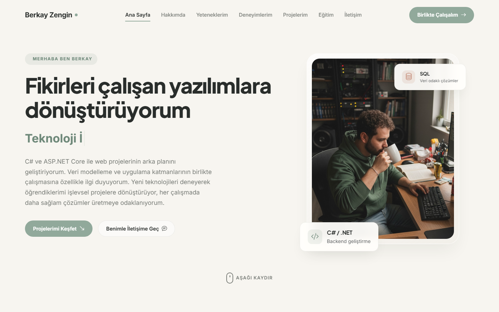 | 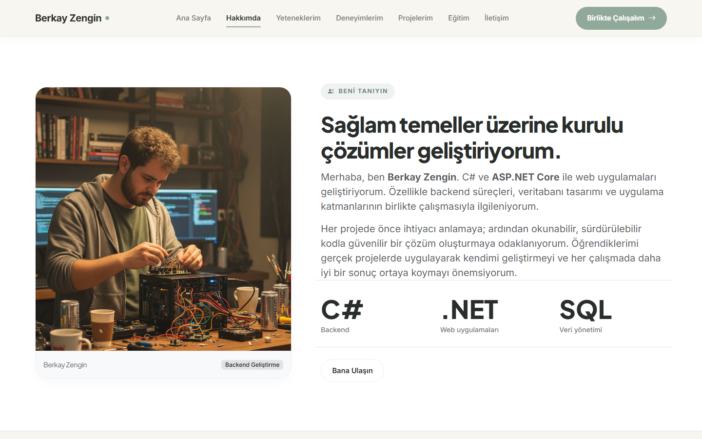 |
| **Yetenekler** | **Deneyimler** |
| 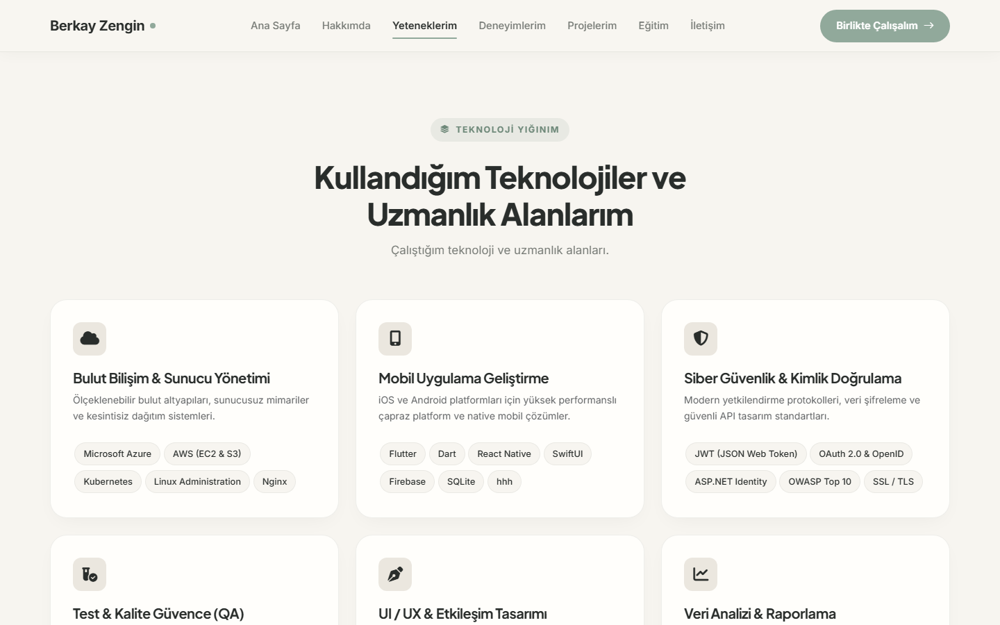 | 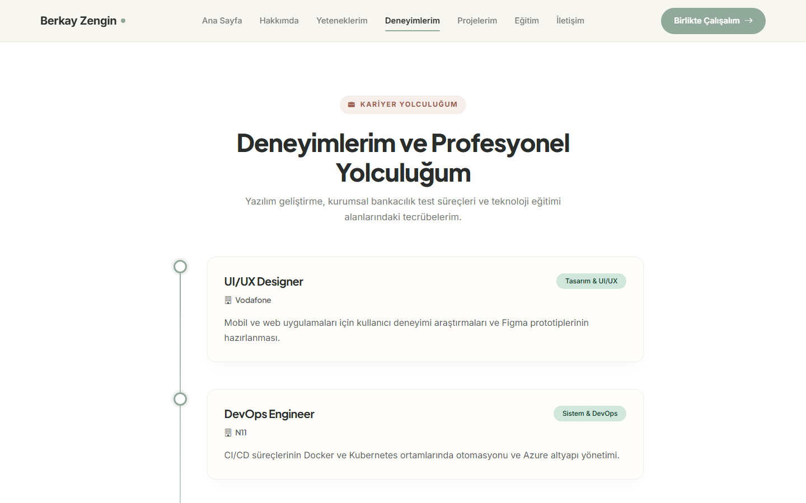 |
| **Projeler** | **Eğitim** |
| 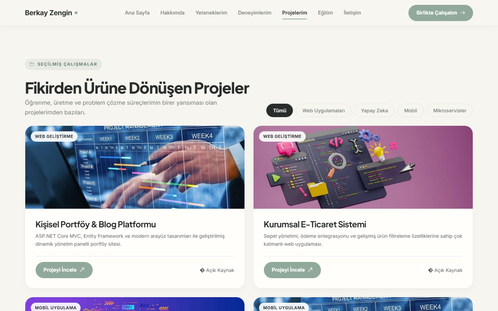 | 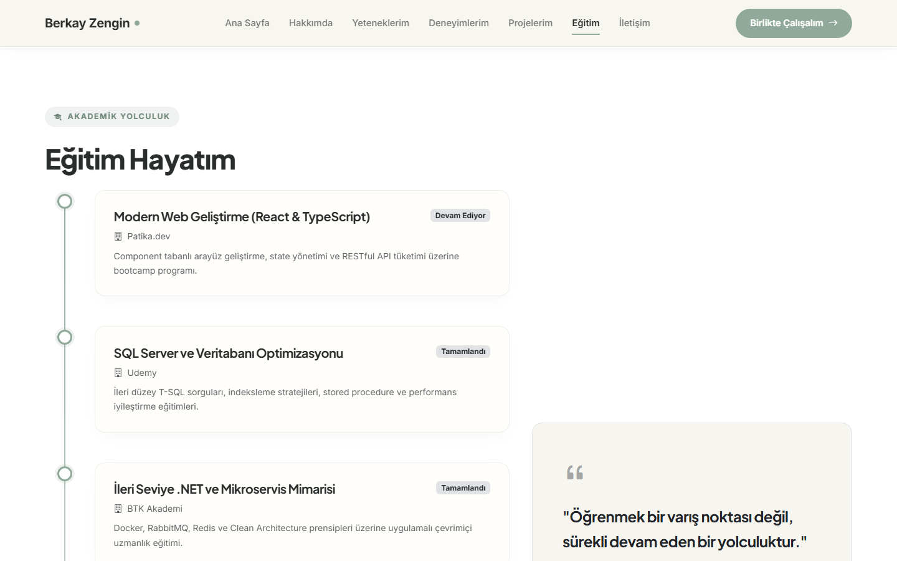 |
| **İletişim** | |
| 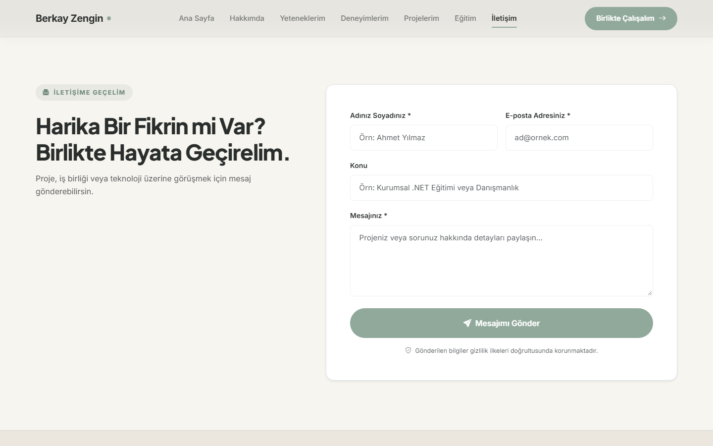 | |

### Admin Paneli

| Dashboard | Projeler |
|---|---|
| 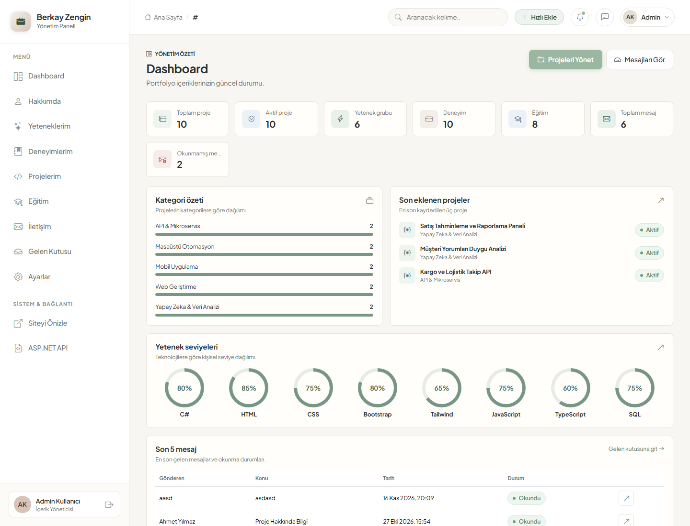 | 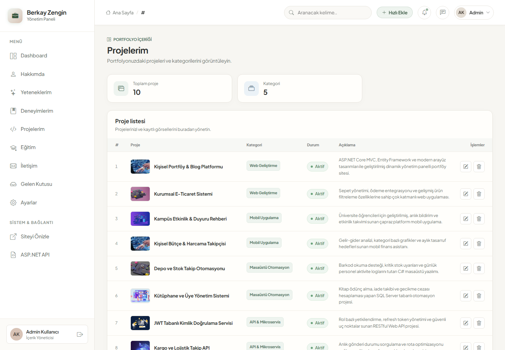 |
| **Gelen Mesajlar** | **Yetenekler** |
| 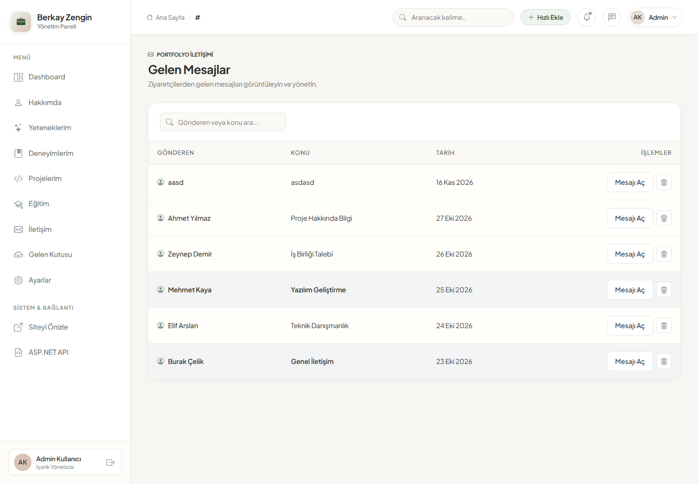 | 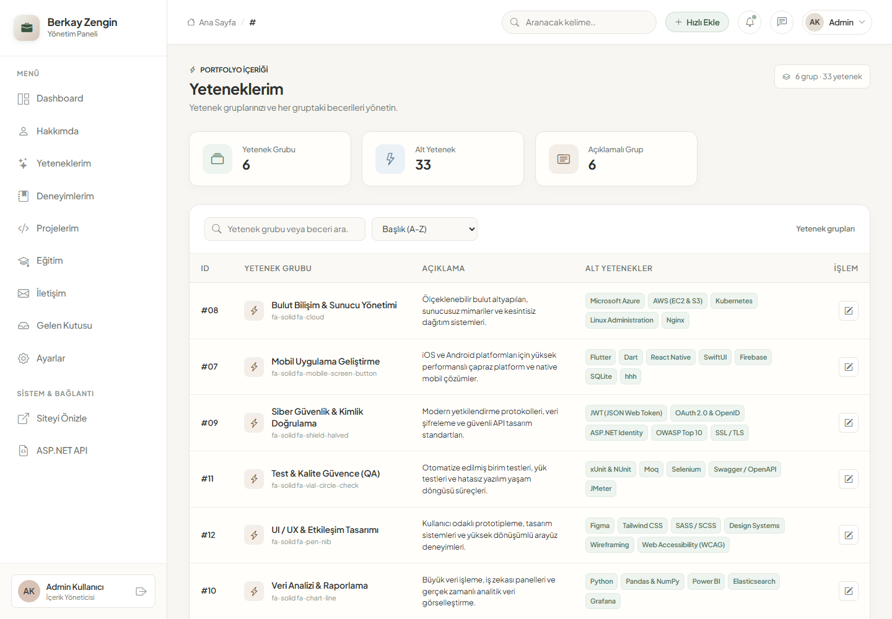 |
| **Deneyimler** | **Hakkımda** |
| 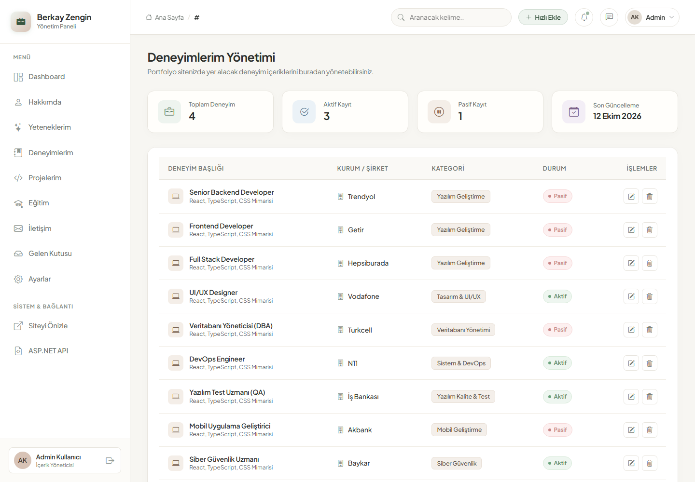 | 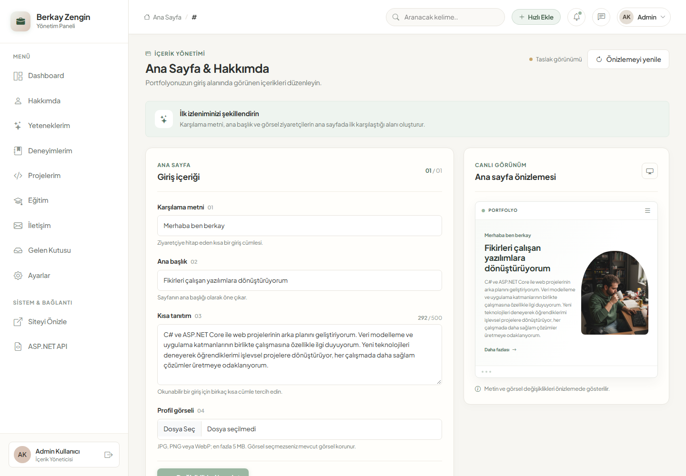 |
| **Eğitim** | |
| 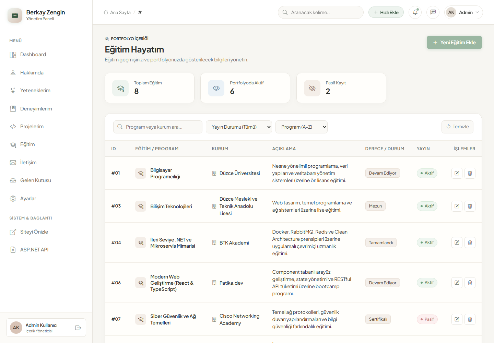 | |

## 🚀 Çalıştırma

1. Bağlantı cümlesini `Bportfolio/Context/PortfolioContext.cs` içinde kendi SQL Server'ınıza göre düzenleyin (varsayılan: `.\SQLEXPRESS`, veritabanı `PortfolioDB`).
2. Veritabanını oluşturun:
   ```bash
   cd Bportfolio
   dotnet ef database update
   ```
3. Uygulamayı başlatın:
   ```bash
   dotnet run
   ```
4. Site: `https://localhost:7270` · Admin paneli: `https://localhost:7270/Admin/Dashboard/Index`

## 🙏 Teşekkür

Eğitim süreci boyunca bilgi ve deneyimlerini paylaşan Murat Yücedağ hocama ve M&Y Yazılım Eğitim Akademi ekibine teşekkür ederim.
